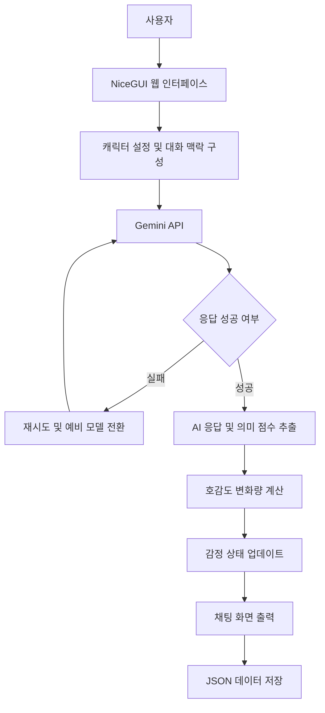

# AI 캐릭터 대화 시뮬레이터

> **2026 Python 수행평가 프로젝트 | NiceGUI × Google Gemini API**
>
> 사용자가 직접 AI 캐릭터의 성격과 말투를 설정하고, 대화에 따라 변화하는 호감도와 감정 상태를 확인할 수 있는 웹 애플리케이션입니다.


---

## 프로젝트 소개

이 프로젝트는 **생성형 AI와 대화형 웹 UI를 결합한 캐릭터 커스터마이징 시뮬레이터**입니다.

사용자는 캐릭터의 이름, 성격, 말투, 관심사를 직접 설정하거나 준비된 프리셋을 선택할 수 있습니다.

캐릭터는 이전 대화와 설정된 성격을 바탕으로 답변을 생성하며, 사용자의 메시지에 따라 호감도와 감정 상태가 변화합니다.

단순한 챗봇을 넘어 다음 기술을 Python으로 구현하는 것을 목표로 제작했습니다.

- LLM API 연동
- 프롬프트 엔지니어링
- 대화 맥락 관리
- 캐릭터 상태 및 호감도 시스템
- JSON 기반 데이터 저장
- NiceGUI 웹 인터페이스 구축

---

## 주요 기능

| 기능 | 설명 |
| --- | --- |
| 캐릭터 커스터마이징 | 이름, 성격, 말투, 관심사 설정 |
| 캐릭터 프리셋 | 미리 준비된 3가지 캐릭터 유형 선택 |
| AI 실시간 채팅 | Gemini API를 활용한 자연어 대화 |
| 호감도 시스템 | 대화 내용을 분석해 0~100 범위의 호감도 변경 |
| 감정 상태 | 대화 결과에 따른 캐릭터 감정 표시 |
| 이벤트 시스템 | 호감도 30, 70, 100 달성 이벤트 |
| 대화 저장 | JSON 파일에 캐릭터 설정과 대화 기록 저장 |
| 대화 내보내기 | 채팅 기록을 TXT 파일로 다운로드 |
| 대화 초기화 | 기존 대화 기록 및 호감도 초기화 |
| API 오류 대응 | Gemini 요청 재시도 및 예비 모델 전환 |

### 1. 캐릭터 커스터마이징

사용자가 원하는 캐릭터를 직접 생성할 수 있습니다.

설정 가능한 항목:

- 이름
- 성격
- 말투
- 관심사

기본적으로 3가지 프리셋을 제공합니다.

- 편안한 친구
- 다정한 선배
- 장난기 많은 친구

### 2. AI 채팅 시스템

Google Gemini API를 활용하여 캐릭터의 답변을 생성합니다.

캐릭터 설정과 최근 대화 맥락을 프롬프트에 포함하여 일관성 있는 응답을 생성합니다.

### 3. 호감도 시스템

사용자 메시지를 분석하여 호감도가 변화합니다.

- 긍정적인 대화: 호감도 증가
- 부정적인 대화: 호감도 감소
- 일반적인 대화: 상황에 따라 유지 또는 변화

키워드가 감지되면 규칙 기반 점수를 사용하며, 그렇지 않으면 Gemini가 문맥을 분석해 변화량을 계산합니다.

호감도는 0~100 사이로 제한됩니다.

### 4. 대화 저장 및 복원

캐릭터 설정과 대화 기록은 `chat_save.json` 파일에 저장됩니다.

프로그램을 재실행해도 저장된 데이터를 불러올 수 있습니다.

또한 대화 기록을 TXT 파일로 내보낼 수 있습니다.

---

## 기술 스택

| 구분 | 기술 | 역할 |
| --- | --- | --- |
| Language | Python 3.12 | 프로그램 개발 |
| Frontend / UI | NiceGUI | 웹 인터페이스 |
| AI | Google Gemini API | AI 대화 및 의미 분석 |
| Model | Gemini 2.5 Flash | 기본 생성형 AI 모델 |
| Configuration | python-dotenv | 환경변수 관리 |
| Storage | JSON | 대화 기록 및 설정 저장 |
| Deployment | Docker | 컨테이너 배포 |

---

## 시스템 아키텍처



### AI 응답 처리 과정

1. 사용자가 메시지를 입력합니다.
2. 캐릭터 설정과 이전 대화 내용을 불러옵니다.
3. Gemini API에 프롬프트를 전달합니다.
4. AI가 답변과 의미 기반 호감도 변화량을 생성합니다.
5. 키워드 분석 결과가 있으면 해당 점수를 우선 적용합니다.
6. 호감도와 감정 상태를 업데이트합니다.
7. AI 답변을 화면에 출력하고 대화 데이터를 저장합니다.

---

## 시작하기

### 1. 저장소 복제

```bash
git clone https://github.com/helloboy7917/2026-PYTHON-PROJECT-main.git
cd 2026-PYTHON-PROJECT-main
```

### 2. 가상환경 생성

Windows PowerShell 기준:

```powershell
python -m venv .venv
.\.venv\Scripts\Activate.ps1
```

### 3. 패키지 설치

```bash
pip install -r requirements.txt
```

### 4. Gemini API 키 설정

프로젝트 루트 디렉터리에 `.env` 파일을 생성합니다.

```env
GEMINI_API_KEY=YOUR_API_KEY

# 선택 사항
GEMINI_MODEL=gemini-2.5-flash
GEMINI_FALLBACK_MODEL=gemini-2.5-flash-lite
PORT=8080
```

API 키는 [Google AI Studio](https://aistudio.google.com/apikey)에서 발급받을 수 있습니다.

> **주의:** `.env` 파일에는 API 키가 포함되므로 GitHub에 업로드하지 마세요.

### 5. 프로그램 실행

```bash
python main.py
```

프로그램 실행 후 브라우저에서 접속합니다.

```text
http://localhost:8080
```

---

## Docker 실행

Docker가 설치되어 있다면 다음 명령어로 실행할 수 있습니다.

```bash
docker compose -f Docker-compose.yml up --build -d
```

접속 주소:

```text
http://localhost:8080
```

컨테이너 종료:

```bash
docker compose -f Docker-compose.yml down
```

---

## 프로젝트 구조

```text
2026-PYTHON-PROJECT-main/
│
├── main.py
│   └── NiceGUI 웹 인터페이스 및 채팅 관리
│
├── ai_engine.py
│   └── Gemini API, 프롬프트, 호감도 계산
│
├── memory.py
│   └── 대화 기록 저장 및 불러오기
│
├── chat_save.json
│   └── 캐릭터 설정 및 대화 데이터
│
├── requirements.txt
│   └── Python 라이브러리 목록
│
├── Dockerfile
│   └── Docker 이미지 설정
│
├── Docker-compose.yml
│   └── Docker 컨테이너 실행 설정
│
├── .gitignore
│   └── Git 추적 제외 파일
│
└── README.md
    └── 프로젝트 설명
```

---

## 핵심 구현 기술

### 1. 프롬프트 엔지니어링

캐릭터의 이름, 성격, 말투, 관심사와 호감도를 시스템 프롬프트에 반영합니다.

이를 통해 동일한 사용자 메시지라도 캐릭터 설정에 따라 서로 다른 응답이 생성되도록 구현했습니다.

### 2. 대화 맥락 관리

최근 대화 내용을 프롬프트에 포함하여 AI가 이전 대화 흐름을 참고하도록 설계했습니다.

### 3. 하이브리드 호감도 계산

호감도 계산에 두 가지 방식을 활용합니다.

- 키워드 기반 규칙 분석
- Gemini 기반 문맥 및 의미 분석

두 결과를 중복 적용하지 않고 상황에 맞는 점수를 선택합니다.

### 4. Gemini API 오류 처리

일시적인 API 요청 제한이나 서버 오류가 발생할 경우 재시도합니다.

기본 모델에서 응답을 생성하지 못하면 예비 모델로 전환합니다.

- 기본 모델: `gemini-2.5-flash`
- 예비 모델: `gemini-2.5-flash-lite`

### 5. 비동기 처리

`asyncio.to_thread()`를 활용하여 Gemini API 요청을 별도 스레드에서 처리합니다.

이를 통해 AI 응답을 기다리는 동안 웹 UI의 이벤트 루프가 직접 차단되는 것을 방지합니다.

---

## 현재 제약 사항

- Gemini API 키와 인터넷 연결이 필요합니다.
- API 사용량 제한에 따라 응답이 실패할 수 있습니다.
- 대화 데이터는 단일 JSON 파일로 관리됩니다.
- 여러 사용자가 동시에 이용하는 서비스보다는 로컬 실습 환경에 적합합니다.
- 공개 저장소에 실제 대화 기록이나 API 키가 포함되지 않도록 주의해야 합니다.

---

## 프로젝트 정보

- **프로젝트 유형:** 2026 Python 수행평가
- **개발 언어:** Python
- **AI 서비스:** Google Gemini
- **웹 프레임워크:** NiceGUI
- **저장소:** [2026-PYTHON-PROJECT-main](https://github.com/helloboy7917/2026-PYTHON-PROJECT-main)
